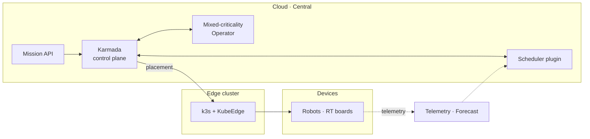

# 원희찬 · Heechan Won

> **Cloud-native edge computing · Real-time scheduling on Kubernetes**
> Making the cloud–edge continuum predictable enough for robots.

쿠버네티스로 클라우드 · 엣지 · 디바이스를 하나의 컴퓨팅 연속체로 묶고, 그 위에서 마감이 있는 작업을 **어디에, 언제, 얼마나 안전하게** 놓을지 결정하는 시스템을 연구하고 만듭니다.
평균 성능이 좋은 클러스터보다, "이 작업은 마감 안에 끝난다"고 약속할 수 있는 인프라를 목표로 합니다.

현재 KETI(한국전자기술연구원)에서 엣지-클라우드 인프라 R&D 를 하고 있습니다.

- 🔭 **Now** — 멀티 클러스터 위 혼합 중요도 스케줄러 · Operator 개발 (KETI SDI)
- 🌱 **Exploring** — 클라우드-엣지 연속체의 실시간 보장, 상태 인지 · 예측 기반 배치
- 🤖 **Hands-on with** — Karmada · KubeEdge · k3s · PREEMPT_RT · ROS 2
- 💬 **Ask me about** — 쿠버네티스 스케줄러 확장, Operator 개발, 엣지 디바이스 운용, 컨트롤 플레인 지연 분석

---

## 하는 일 · What I Do

### 🌐 Multi-cluster Orchestration
여러 쿠버네티스 클러스터를 하나처럼 다루는 연합(federation) 구조에서, 작업을 어느 클러스터 · 어느 노드에 언제 보낼지를 제어합니다. 클라우드처럼 직접 밀어 넣는 클러스터와, 엣지처럼 스스로 가져가는 클러스터가 섞인 환경을 다룹니다.

- 클러스터 단위 결정과 클러스터 안의 노드 고정, 두 단계 결정을 어떻게 일관되게 맞출 것인가
- 결정이 내려진 순간과 실제로 전달되는 순간 사이의 틈에서 생기는 잘못된 배치를 어떻게 막을 것인가
- 정책(Propagation · Override)만으로 전달 시점과 배치 위치를 얼마나 세밀하게 제어할 수 있는가

### ⏱️ Real-time & Mixed-Criticality Scheduling
범용 쿠버네티스 위에서 마감이 있는 작업의 응답 시간을 지키는 방법을 연구합니다. 실시간 시스템 이론(혼합 중요도, 이용률 기반 수용 제어)을 클라우드 네이티브 스케줄링에 옮겨 오는 일입니다.

- 작업을 중요도 등급으로 나누고, 등급마다 배치 규칙과 실행 정책을 달리 적용
- 최상위 등급은 "커널 최악 지연 + 최악 실행 시간 + 여유 ≤ 마감"을 만족하는 실시간 노드에만 배치
- 노드별 이용률 상한으로 실시간 작업끼리의 과밀을 막는 수용 제어
- SCHED_FIFO · CPU 격리 같은 실행 정책을 등급에 맞춰 자동으로 지정하고 PREEMPT_RT 커널 기기와 연동

### 📡 Edge Computing & Device Integration
경량 쿠버네티스(k3s)와 KubeEdge 로 로봇 · ARM64 임베디드 보드를 클러스터의 일원으로 다룹니다. 연구실 밖, 인터넷이 없는 현장에서도 그대로 돌아가는 것을 기준으로 삼습니다.

- 엣지가 기기를 찾아 노드로 가입시키는 디바이스 자동 등록
- PREEMPT_RT 커널 기기의 운용과, 컨테이너 런타임이 실시간 기기에 주는 영향 추적
- 오프라인 현장에 그대로 설치하는 폐쇄망 배포 키트
- CPU · NPU · GPU 가 섞인 이기종 하드웨어를 등급으로 나눠 작업 요구와 맞추는 배치

### 🧭 Context-aware & Predictive Placement
노드 지표, 자원 예측, 통신 · CPU · 배터리 위험도, 기기의 보호 모드 같은 상태 정보를 스케줄링 판단에 넣습니다. 움직이는 기기는 몇 초 사이에도 상태가 바뀌기 때문에, 지금 값만이 아니라 추세와 위험을 함께 봅니다.

- 정확도 · 지연 · 에너지(ALE) 기준의 위치별 점수와 미션 단위 공동 배치
- 한 번 튄 값이 아니라 연속으로 나빠진 위치만 걸러내는 위험도 판단
- 배치마다 탈락 사유 · 차순위 후보 · 단계별 소요 시간을 남기는 설명 가능한 스케줄링

### ⚡ Control-plane Latency & Observability
요청 접수부터 디바이스 위 컨테이너 실행까지의 지연을 단계별로 쪼개 재고, 병목을 실측으로 분리해 줄입니다.

- admission webhook, 컨트롤러 캐시 초기화, 설정 읽기, etcd 쓰기, 엣지 동기화 같은 숨은 지연 찾기
- 같은 실험을 다른 서버에서 재현해 하드웨어 · 부하 · 우선순위의 영향을 하나씩 떼어 보기
- Prometheus · Grafana 로 노드 · 디바이스 지표를 모으고 보기

### 🧩 Kubernetes Extension
쿠버네티스를 고쳐 쓰지 않고, 확장 지점으로 새 동작을 붙입니다.

- Operator(controller-runtime) · CRD · Admission Webhook
- 스케줄러 프레임워크 플러그인 (Filter · Score · Normalize)
- 클러스터 앞단의 요청 변환 · 검증 API

---

## 프로젝트 · Projects

### 🚗 SDI — 미래 모빌리티를 위한 소프트웨어 정의형 인프라스트럭처
**KETI · 진행 중**

로봇 · 엣지 서버 · 클라우드를 묶은 멀티 클러스터 위에서, 모빌리티 미션의 작업들을 중요도와 마감에 맞춰 실시간으로 배치하는 플랫폼입니다.
**스케줄링 파트**(미션 API · 혼합 중요도 Operator · 멀티 클러스터 스케줄러)와 **디바이스 자동 등록**을 맡고 있습니다.

| 구성요소 | 만든 것 | 기술 |
|---|---|---|
| **Mission Bundle API** | 외부 미션 요청을 검증해 쿠버네티스 · Karmada 객체로 변환. 작업 카탈로그로 빠진 마감 · 실행 시간을 채우고, 기기 고정 전에는 전달을 보류 | Python · FastAPI |
| **Mixed-Criticality Operator** | 작업 중요도 등급(HC · MC · LC) 산정, 최상위 등급의 마감 보장 검사, 노드별 이용률 원장, 기기 고정과 전달 보류 해제, 등급별 실행 정책, 미션 상태 · 이벤트 기록 | Go · controller-runtime · CRD · Webhook |
| **Multi-cluster Scheduler Plugin** | 자원 · 가속기 · 실시간 자격 · 신선도 · 배터리 · 위험도 · 운용 모드를 보는 필터 체인, 정확도 · 지연 · 에너지(ALE) 점수, 상황별 알고리즘 선택(의도 · 추세 예측 · 미션 단위 공동 배치), 결정 근거 기록, 후보 없음 자동 재시도 | Go · Karmada scheduler framework |
| **Device Auto-registration** | 엣지가 로봇 · 보드를 찾아 KubeEdge 노드로 가입시키고 지표 수집까지 붙이는 자동 등록, 폐쇄망 설치 키트 | Bash · KubeEdge · ROS 2 |
| **Placement Latency Engineering** | 요청 → 기기 위 컨테이너 배치 지연의 단계별 측정과 병목 제거, 별도 시험 서버에서의 재현 실험 | Kubernetes · Prometheus |

#### Engineering Highlights
- **배치 직후 Pod 재생성 제거** — 스케줄러 결정과 노드 고정 정책 사이의 경합으로 작업이 엉뚱한 노드에 먼저 떴다가 옮겨지던 문제를, 전달 보류 · 결정 전 사전 고정 · 정책 생성 대기의 세 가지 장치로 없앰
- **마감 보장 경로 분리** — 최상위 등급 작업은 실시간 자격 · 마감 검사 · 이용률 원장을 모두 통과해야만 기기에 고정되고, 통과 전에는 엉뚱한 노드에서 실행되지 않도록 설계
- **컨트롤러 콜드 스타트 지연 제거** — 재시작 직후 첫 작업만 늦던 원인을 컨트롤러 캐시 지연 생성으로 찾아내고, 시작 시 캐시 예열로 해결
- **요청 경로에서 설정 읽기 제거** — 요청 처리 중 주기적으로 끼어들던 설정 다시 읽기를 백그라운드 갱신으로 옮김
- **현장 무선 환경 대응** — 실제 Wi-Fi 지연 때문에 자기 기기에 지정된 작업이 통신 위험도로 탈락하던 문제를, 위험도 성분을 나눠 판단하도록 바꿔 해결
- **후보 없음 자동 복구** — 갈 곳이 없던 작업을 주기적으로 다시 검사해, 기기가 돌아오면 사람 손 없이 다시 배치
- **컨트롤 플레인 병목 분리** — 두 서버의 성능 차이를 디스크 · CPU 수와 클럭 · 우선순위 · 배경 부하 · webhook 경로로 하나씩 재현해 원인 후보를 좁힘

#### 검증
- 실제 로봇(TurtleBot)과 PREEMPT_RT 보드(Raspberry Pi 5)에서 최상위 등급 작업의 배치 · 고정 · 실행 정책까지 종단 시험
- 등급 → 배치 → 고정 → 실행 정책 → 기록 흐름을 항목별로 검사하는 통합 시험 자동화
- 운영 환경과 분리된 시험 서버에 같은 구성을 세워 반복 측정

---

## 일하는 방식 · How I Work

- **측정 먼저** — 추측 대신 단계마다 시각을 찍어 병목을 찾고, 고친 뒤 같은 조건으로 다시 잽니다.
- **되돌릴 수 있게** — 모든 변경은 백업 → 적용 → 시험 → 되돌리기를 한 묶음으로 만듭니다. 공용 운영 환경에서도 안심하고 바꿀 수 있게.
- **기록으로 남기기** — 결정 · 근거 · 명령 · 결과를 날짜별로 남겨, 누가 이어받아도 같은 판단을 다시 할 수 있게 합니다.
- **설명 가능한 시스템** — 스케줄러가 내린 결정마다 이유를 데이터로 남깁니다. "왜 여기에 배치됐나"에 언제든 답할 수 있도록.

---

## Tech Stack

| 분야 | |
|---|---|
| Orchestration |     |
| Real-time & Edge |     |
| Languages |    |
| Frameworks |   |
| Observability |   |
| Runtime & Tools |    |

---

## Research Interests

- **Cloud-Edge Continuum의 실시간 보장** — 클라우드에서 기기까지 이어진 경로 전체에서 응답 시간을 약속하는 방법
- **혼합 중요도 시스템 × 쿠버네티스** — 안전에 중요한 작업과 일반 작업이 같은 클러스터를 나눠 쓸 때의 격리와 보장
- **모바일 로봇을 위한 상태 인지 스케줄링** — 배터리 · 통신 · 부하가 계속 바뀌는 기기에서의 예측 기반 배치와 미션 이관
- **멀티 클러스터 컨트롤 플레인 지연** — 연합 클러스터에서 요청이 실제 실행으로 바뀌기까지의 지연 구조와 최적화
