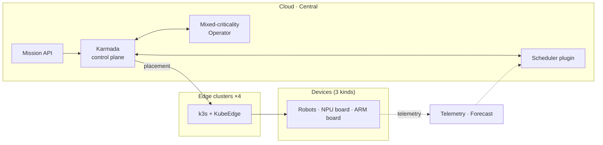

# 원희찬 · Heechan Won

> **Kubernetes · Edge Computing · Real-time Systems**
> 클라우드에서 엣지, 디바이스까지 하나의 쿠버네티스로 묶고, 그 위에서 "제때 끝나야 하는 작업"을 다룹니다.

쿠버네티스를 데이터센터 밖으로 꺼내, 엣지 서버와 로봇 · 임베디드 보드까지 이어진 **클라우드-엣지 연속체**를 만들고 운용합니다.
관심은 늘 같은 질문입니다. *이 작업을 어디에, 언제 놓아야 마감 안에 끝나는가.* 그리고 *그 결정이 실제 실행으로 바뀌기까지 어디서 시간이 새는가.*

현재 KETI(한국전자기술연구원)에서 엣지-클라우드 인프라 R&D 를 연구하고 있습니다.

- 🔭 **Now** — 멀티 클러스터 스케줄러 확장 · 혼합 중요도 Operator · 엣지 디바이스 자동 등록
- 🌱 **Exploring** — 엣지 컨트롤 플레인 지연 구조, 상태 인지 · 예측 기반 배치, 컨테이너 환경의 실시간 보장
- 🤖 **Hands-on with** — Kubernetes · Karmada · k3s · KubeEdge · PREEMPT_RT · ROS 2
- 💬 **Ask me about** — 스케줄러 프레임워크 플러그인, controller-runtime Operator, 엣지 노드 운용, 배치 지연 분석

---

## 기술 영역 · Focus Areas

### ☸️ Kubernetes Extension
쿠버네티스를 포크하지 않고 확장 지점으로 새 동작을 붙입니다.

- **스케줄러 프레임워크 플러그인** — Filter · Score · NormalizeScore 단계에 자원 · 가속기 · 위험도 · 실시간 자격 검사를 넣고, 결정마다 탈락 사유와 차순위 후보를 남기기
- **Operator (controller-runtime)** — CRD 로 작업의 의도(중요도 · 마감 · 실행 시간)를 받아 등급을 매기고, 하위 리소스(정책 · 라벨 · 이벤트)를 조정 루프로 맞추기
- **Admission Webhook · 요청 변환 API** — 외부 요청을 검증하고 쿠버네티스 객체로 바꾸며, 빠진 값을 카탈로그로 채우기
- 컨트롤러 캐시 · informer 동작, 조정 순서와 경합, 재시작 직후 동작 같은 "운영에서만 보이는" 문제 다루기

### 🌐 Multi-cluster & Federation
여러 클러스터를 하나처럼 다루는 연합 구조(Karmada)에서 작업의 전달 위치와 시점을 제어합니다.

- 클러스터 단위 결정과 클러스터 안 노드 고정, **두 단계 결정을 일관되게** 맞추기
- 결정과 실제 전달 사이의 틈에서 생기는 잘못된 배치 막기: 전달 보류 · 사전 고정 · 정책 준비 대기
- Propagation · Override 정책만으로 전달 시점과 배치 위치를 세밀하게 제어하기
- 직접 밀어 넣는(push) 클러스터와 스스로 가져가는(pull) 엣지 클러스터가 섞인 환경

### 📡 Edge Computing
경량 쿠버네티스(k3s)와 KubeEdge 로 엣지 서버, 로봇, ARM64 보드를 클러스터의 일원으로 다룹니다. 연구실 밖, 인터넷이 없는 현장에서도 그대로 돌아가는 것이 기준입니다.

- **디바이스 자동 등록** — 엣지가 mDNS 로 기기를 찾아 노드로 가입시키고, 기기 특성(가속기 · 센서 · 구동부)을 라벨로 붙이고, 지표 수집 대상까지 자동으로 맞추기. 엣지가 여러 대여도 기기가 알린 소속 엣지만 데려가도록
- **이기종 하드웨어** — CPU · NPU · GPU 가 섞인 노드를 등급으로 나눠 작업 요구와 맞추기. 드라이버는 보이지만 장치 플러그인이 없어 실제로는 할당할 수 없는 가속기 같은 함정 걸러내기
- **폐쇄망 배포** — 오프라인 현장에 그대로 설치하는 설치 키트와 리허설 환경
- 무선(Wi-Fi) 링크 · 배터리 · 기기 재부팅처럼 데이터센터에는 없는 변수를 운영 대상으로 다루기

### ⏱️ Real-time on Kubernetes
범용 쿠버네티스 위에서 마감이 있는 작업의 응답 시간을 지키는 방법을 연구합니다. 실시간 시스템 이론(혼합 중요도, 이용률 기반 수용 제어)을 클라우드 네이티브 스케줄링으로 옮깁니다.

- 작업을 중요도 등급으로 나누고, 등급마다 배치 규칙과 실행 정책을 달리 적용
- 최상위 등급은 "커널 최악 지연 + 최악 실행 시간 + 여유 ≤ 마감"을 만족하는 실시간 노드에만 배치
- 노드별 이용률 원장으로 실시간 작업끼리의 과밀을 막는 수용 제어
- SCHED_FIFO · CPU 격리를 등급에 맞춰 자동 지정하고 PREEMPT_RT 커널 기기와 연동, 장애 시 보호 모드로 강등

### 🧭 Context-aware Placement
움직이는 기기는 몇 초 사이에도 상태가 바뀝니다. 지금 값만이 아니라 추세와 위험을 함께 봅니다.

- 노드 지표 · 자원 예측 · 통신 · CPU · 배터리 위험도 · 기기 운용 모드를 배치 판단에 넣기
- 한 번 튄 값이 아니라 연속으로 나빠진 위치만 걸러내는 위험도 판단
- 정확도 · 지연 · 에너지(ALE) 점수와 미션 단위 공동 배치, 후보가 없을 때 자동 재시도

### ⚡ Control-plane Latency & Observability
요청 접수부터 디바이스 위 컨테이너 실행까지를 단계별로 쪼개 재고, 병목을 실측으로 분리해 줄입니다.

- API 서버 입장 검사, admission webhook, 컨트롤러 캐시 초기화, 설정 읽기, etcd 쓰기, 엣지 동기화 같은 숨은 지연 찾기
- 같은 실험을 다른 서버에서 재현해 디스크 · CPU · 우선순위 · 배경 부하의 영향을 하나씩 떼어 보기
- Prometheus · Grafana 로 노드 · 디바이스 지표, InfluxDB 로 KPI 시계열을 남겨 시험 대시보드와 연동

---

## 풀어 본 문제들 · Things I've Debugged

실제 클러스터에서 만난 문제와 원인입니다. 대부분 "평균은 괜찮은데 가끔 늦다" 또는 "가끔 다시 만들어진다"로 시작했습니다.

| 증상 | 원인 | 해결 |
|---|---|---|
| 특정 엣지로 가는 작업만 매번 수십 ms 늦음 | 쿼터가 없는 네임스페이스에서 API 서버가 주기적으로 다시 하는 목록 조회가, 일관 읽기(consistent read) 대기로 가끔 길어짐 | 재시작 없이 검사 경로를 바꿔 해당 구간 약 80 ms → 15 ms |
| 배치 직후 Pod 가 한 번 더 만들어짐 | 스케줄러 결정과 노드 고정 · 실행 정책 생성 사이의 경합으로 정책 없이 먼저 전달 | 전달 보류 · 결정 전 사전 고정 · 정책 준비 대기 |
| GPU 작업이 할당 불가 노드로 가서 Pending | 드라이버는 동작해 "사용 가능"으로 보고되지만 장치 플러그인이 없어 allocatable 에 없음 | 클러스터 · 배치 후보 행 단위 확장 자원 필터 |
| 컨트롤러 재시작 직후 첫 작업만 느림 | 감시하지 않던 리소스를 처음 읽을 때 캐시를 늦게 만들고 동기화 대기 | 시작 시 캐시 예열 |
| 몇십 초에 한 번 요청 하나가 멈춤 | 요청 처리 안에서 만료된 설정을 다시 읽고 파싱 | 백그라운드 갱신 · 빠른 파서 |
| 자기 기기에 지정된 작업이 탈락 | 실제 Wi-Fi 지연이 통신 위험도로 잡혀 해당 기기를 제외 | 위험도 성분을 나눠 지정 기기에서는 통신 성분을 따로 판단 |
| 두 서버에서 같은 실험의 지연이 2배 차이 | 디스크가 아니라 CPU · 연결 경로 차이 | 조건을 하나씩 바꿔 재현해 원인 후보를 좁힘 |
| 실시간 보드가 수십 분 뒤 재부팅 | 1초마다 도는 exec probe 가 런타임을 반복 실행, RT 커널에서 경고 누적 | probe 제거 · 원인 프로세스 추적 |

---

## 대표 프로젝트 · Featured Project

### 🚗 SDI — 미래 모빌리티를 위한 소프트웨어 정의형 인프라 (KETI · 진행 중)
로봇 · 엣지 서버 · 클라우드를 묶은 멀티 클러스터 위에서 미션 작업을 중요도와 마감에 맞춰 배치하는 플랫폼입니다. **스케줄링 파트**(미션 API · 혼합 중요도 Operator · 멀티 클러스터 스케줄러)와 **디바이스 자동 등록**을 맡고 있습니다.

| 구성요소 | 내용 | 기술 |
|---|---|---|
| Mission Bundle API | 외부 미션 요청 검증 · 쿠버네티스 객체 변환, 카탈로그로 빠진 값 채우기, 고정 전 전달 보류 | Python · FastAPI |
| Mixed-Criticality Operator | 중요도 등급 산정, 마감 보장 검사, 이용률 원장, 기기 고정 · 보류 해제, 등급별 실행 정책, 미션 상태 기록 | Go · controller-runtime · CRD |
| Multi-cluster Scheduler Plugin | 필터 체인(자원 · 가속기 · 실시간 자격 · 신선도 · 배터리 · 위험도 · 운용 모드), ALE 점수, 상황별 알고리즘, 결정 근거, 후보 없음 재시도 | Go · Karmada scheduler framework |
| Device Auto-registration | 엣지 주도 기기 탐색 · 노드 가입 · 특성 라벨 · 지표 수집 자동화, 폐쇄망 키트 | Bash · Python · KubeEdge · ROS 2 |

**검증** — 클라우드 1 · 엣지 4 · 3종 디바이스(로봇 · NPU 보드 · 일반 ARM 보드) 구성에서, 시험 대시보드의 장애 주입(CPU 부하 · 네트워크 지연) 시나리오로 마감 미준수율과 배치 지연을 자동 측정 · 기록. 실제 로봇과 PREEMPT_RT 보드에서 배치 · 고정 · 실행 정책까지 종단 시험.

---

## 일하는 방식 · How I Work

- **측정 먼저** — 추측 대신 단계마다 시각을 찍어 병목을 찾고, 고친 뒤 같은 조건으로 다시 잽니다.
- **가르는 실험** — 원인 후보가 둘이면 하나만 바꾼 실험으로 가릅니다. (예: 느림이 "그 엣지"를 따라가는지 "그 순서"를 따라가는지)
- **되돌릴 수 있게** — 모든 변경은 백업 → 적용 → 시험 → 되돌리기를 한 묶음으로. 공용 운영 환경에서도 안심하고 바꿀 수 있게.
- **기록으로 남기기** — 결정 · 근거 · 명령 · 결과를 날짜별로 남겨, 누가 이어받아도 같은 판단을 다시 할 수 있게.
- **설명 가능한 시스템** — "왜 여기에 배치됐나"에 언제든 데이터로 답할 수 있도록.

---

## Tech Stack

| 분야 | |
|---|---|
| Orchestration |     |
| Real-time & Edge |     |
| Languages |    |
| Frameworks |   |
| Observability |    |
| Runtime & Tools |    |

---

## Research Interests

- **엣지 컨트롤 플레인의 지연 구조** — 연합 · 엣지 클러스터에서 요청이 실제 실행으로 바뀌기까지 어디서 시간이 쓰이는가
- **컨테이너 환경의 실시간 보장** — 범용 오케스트레이터 위에서 마감 있는 작업과 일반 작업이 같은 노드를 나눠 쓸 때의 격리와 보장
- **상태 인지 · 예측 기반 배치** — 배터리 · 통신 · 부하가 계속 바뀌는 모바일 기기에서의 배치와 작업 이관
- **현장형 엣지 운용** — 폐쇄망 · 무선 · 이기종 하드웨어 환경에서 사람 손 없이 굴러가는 클러스터
